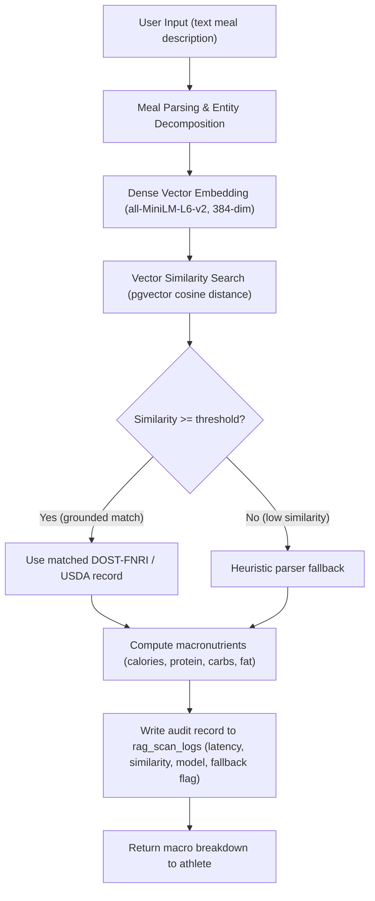
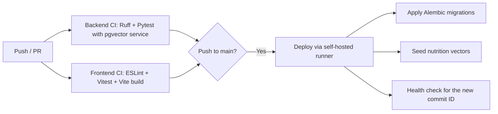

# NutriSync-RAG

<div align="center">


**An activity-synchronized nutritional retrieval-augmented generation and geolocation workout tracking platform.**

[](https://fastapi.tiangolo.com)
[](https://react.dev)
[](https://www.typescriptlang.org)
[](https://github.com/pgvector/pgvector)
[](https://tailwindcss.com)
[](https://www.docker.com)
[](https://pytest.org)
[](https://github.com/astral-sh/ruff)
[](#-license--acknowledgments)

_Live URL: added after deployment (see [CI/CD & Deployment](#-cicd--deployment))_ &nbsp;•&nbsp;
[📖 System Manual (D1)](docs/01-system-documentation/README.md) &nbsp;•&nbsp;
[👤 User Manual (D2)](docs/02-user-manual/README.md) &nbsp;•&nbsp;
[🔬 Research Paper (D4)](docs/04-paper/README.md)

</div>

---

## 📌 Table of Contents

- [Overview](#-overview)
- [Key Features](#-key-features)
  - [Athlete & Member](#athlete--member-athlete)
  - [Coach & Administrator](#coach--administrator-admin)
- [System Architecture](#-system-architecture)
- [RAG Nutrition Pipeline](#-rag-nutrition-pipeline)
- [Technology Stack](#-technology-stack)
- [Project Directory Structure](#-project-directory-structure)
- [Getting Started](#-getting-started)
  - [Prerequisites](#prerequisites)
  - [Method 1: Docker Compose (Recommended)](#method-1-docker-compose-recommended)
  - [Method 2: Bare-Metal Local Development](#method-2-bare-metal-local-development)
- [Database Seeding](#-database-seeding)
- [Demo Credentials](#-demo-credentials)
- [Environment Variables](#-environment-variables)
- [API Reference](#-api-reference)
- [Testing & Quality Assurance](#-testing--quality-assurance)
- [CI/CD & Deployment](#-cicd--deployment)
- [Research & Evaluation](#-research--evaluation)
- [Academic Context](#-academic-context)
- [License & Acknowledgments](#-license--acknowledgments)

---

## 💡 Overview

Standard fitness applications suffer from two fundamental disconnects:
1. **Static Macro Targets:** Prescribing rigid, fixed daily caloric and macronutrient allowances regardless of daily fluctuations in actual athletic energy expenditure.
2. **LLM Nutritional Hallucination:** Relying on ungrounded generative AI models for meal logging that hallucinate macro values, especially for regional cuisines (such as Filipino dishes).

**NutriSync-RAG** addresses both problems with a grounded architecture:
- **Retrieval-Augmented Generation (RAG):** Splits a meal description into items and quantities, retrieves the closest food from the **DOST-FNRI** (Philippine Food and Nutrition Research Institute) and **USDA FoodData Central (SR Legacy)** tables with a hybrid score (word overlap plus 384-dimensional embedding similarity), and scales that food's per-100 g macros by the estimated grams. Embeddings use `all-MiniLM-L6-v2` when `sentence-transformers` is installed; otherwise a built-in deterministic hash embedding is used, which is the case in the default Docker image. Matching runs in Python over the knowledge-base rows; the stored `pgvector` column is not used for search.
- **Dynamic Activity Synchronization:** Estimates energy expenditure from weightlifting volume (MET-based) and GPS road/trail activities (distance, time, and elevation gain), then scales daily caloric, carbohydrate, and protein targets. These are estimates; heart rate is not used.

---

## ✨ Key Features

### Athlete & Member (`athlete`)

- **📊 Dynamic Activity-Synced Dashboard**
  - Macro progress rings for calories, protein, carbohydrates, and fat.
  - Daily allowance scaling derived from logged training expenditure.
  - Weekly volume totals.
- **🥑 Grounded RAG Food Macro Scanner**
  - Natural language meal decomposition (text input; photo input is not implemented yet).
  - Semantic vector retrieval against DOST-FNRI and USDA composition tables.
  - Cosine similarity scores with a per-item serving breakdown.
  - Heuristic parser fallback when similarity is low.
- **🏋️ Workout & Routine Logger**
  - Reusable **Workout Routines (Templates)** that pre-populate a split.
  - Exercise, set, rep, and weight logging with a **Rest Timer**.
  - Automatic **Personal Record (PR)** detection.
- **🗺️ Geolocation Road & Trail Tracker**
  - Browser GPS tracking for **Run**, **Walk**, **Ride**, and **Hike**.
  - Road vs. trail surface type, with elevation gain.
  - Route rendering on **Leaflet / OpenStreetMap**.
  - Estimated energy expenditure and calories burned.
- **👥 Social & Community Training Feed**
  - Publish posts, workouts, and GPS routes to a shared feed.
  - **Kudos** and threaded **comments**.
  - Coach badges on coach-approved activity.

### Coach & Administrator (`admin`)

- **🛡️ Custom Exercise Moderation**
  - Review, approve, or reject user-submitted custom exercises.
  - Set muscle group, category, and MET value.
- **🏆 PR Verification**
  - Mark athlete PR claims as verified.
- **🔍 RAG Traceability Log**
  - Per-inference record: query, retrieved item IDs, top similarity score, predicted macros, latency, and whether the fallback was used (Requirement T4).
- **📚 Nutrition Knowledge Base**
  - List the indexed DOST-FNRI and USDA items.

---

## 🏗️ System Architecture

NutriSync-RAG is a containerized, multi-service system behind a reverse proxy:

```
                      [ User Browser (Mobile / Desktop) ]
                                      |
                                      | HTTPS (Tailscale Funnel)
                                      v
                        [ Caddy 2 Reverse Proxy ]
                       /                         \
         / (Frontend static)                      \ /api/* (REST API)
                     v                             v
        [ React 18 + Vite (Nginx) ]      [ FastAPI Backend (Python 3.10+) ]
        - TypeScript, Tailwind CSS       - SQLAlchemy 2.0 (Async) + Alembic
        - Leaflet.js                     - Pydantic v2 & JWT Auth
                                                   |
                                                   | SQL + vector search
                                                   v
                                  [ PostgreSQL 17 + pgvector ]
                                  - 384-dim embeddings
                                  - Persistent Docker volume
```

---

## 🧠 RAG Nutrition Pipeline



---

## 💻 Technology Stack

| Layer | Technologies |
| :--- | :--- |
| **Frontend Client** | **React 18.3**, **TypeScript 5.6**, **Vite 5.4**, **Tailwind CSS 3.4**, **Framer Motion 11.11**, **Leaflet.js 1.9**, **Lucide React**, **Vitest** |
| **Backend API** | **Python 3.10+**, **FastAPI 0.115**, **Pydantic v2.9**, **SQLAlchemy 2.0 (Async)**, **Alembic 1.13**, **HTTPX**, **Pytest** |
| **Database & Vector Engine** | **PostgreSQL 17** with **pgvector** (cosine distance on 384-dim embeddings), SQLite for bare-metal dev |
| **Machine Learning / NLP** | **`sentence-transformers/all-MiniLM-L6-v2`** (384-dim semantic vectors) |
| **DevOps & Ingress** | **Docker Engine**, **Docker Compose**, **Caddy 2** (reverse proxy), **Tailscale Funnel** (public HTTPS) |
| **Quality & Linting** | **Ruff**, **ESLint 9**, **pytest-cov** (60% minimum enforced in CI) |

---

## 📁 Project Directory Structure

```text
nutri-sync/
├── backend/
│   ├── alembic/                      # Database migrations (schema source of truth on PostgreSQL)
│   ├── app/
│   │   ├── api/                      # Health & v1 REST endpoints
│   │   │   └── v1/                   # Auth, Workouts, Runs, RAG, Community, Sync
│   │   ├── core/                     # Configuration, JWT security, logging
│   │   ├── db/                       # SQLAlchemy models and sessions
│   │   ├── schemas/                  # Pydantic validation schemas
│   │   ├── scripts/                  # Data ingestion & seeder utilities
│   │   │   ├── data/                 # DOST-FNRI (101 items) & USDA SR Legacy (7,793 items) CSVs
│   │   │   ├── evaluate_scanner.py   # RAG benchmark script
│   │   │   ├── seed_demo_data.py     # Demo accounts, splits, runs, and PRs
│   │   │   └── seed_nutrition.py     # Vector indexing seeder
│   │   └── services/                 # RAG, embeddings, MET calculations, GPS routing
│   ├── tests/                        # Pytest suite
│   ├── Dockerfile                    # Backend container definition
│   └── requirements.txt              # Python dependencies
├── frontend/
│   ├── src/
│   │   ├── components/               # UI components (rings, feed, modals, rest timer, maps)
│   │   ├── context/                  # React auth context
│   │   ├── pages/                    # Route views (dashboard, scanner, logger, feed, admin)
│   │   ├── services/                 # API client
│   │   └── types/                    # Shared TypeScript types
│   ├── Dockerfile                    # Vite build + Nginx static server
│   └── package.json                  # Dependencies and npm scripts
├── deploy/
│   └── Caddyfile                     # Reverse proxy routing & security headers
├── docs/                             # Academic & engineering deliverables
│   ├── 01-system-documentation/      # D1 (in progress)
│   ├── 02-user-manual/               # D2 (in progress)
│   ├── 03-api/                       # D3: openapi.yaml
│   ├── 04-paper/                     # D4 (in progress)
│   ├── diagrams/                     # Planned diagram sources
│   └── evaluation/                   # Scanner benchmark results
├── scripts/                          # Database backup & restore scripts
├── compose.yaml                      # Docker Compose services
├── .env.example                      # Environment variable template
└── README.md
```

---

## 🚀 Getting Started

### Prerequisites

- [Docker Desktop](https://www.docker.com/products/docker-desktop/) (Docker Engine $\ge 24.0$, Docker Compose v2)
- *Or for local bare-metal execution:* **Python 3.10+** and **Node.js 20+**

---

### Method 1: Docker Compose (Recommended)

1. **Clone the repository:**
   ```bash
   git clone https://github.com/yuri-salise/nutri-sync.git
   cd nutri-sync
   ```

2. **Configure environment variables:**
   ```bash
   cp .env.example .env
   ```
   *(Set `DB_PASSWORD` and `SECRET_KEY` in `.env`)*

3. **Build and launch containers:**
   ```bash
   docker compose up -d --build
   ```

4. **Apply migrations and seed data:**
   ```bash
   docker compose exec api alembic upgrade head
   docker compose exec api python -m app.scripts.seed_nutrition
   docker compose exec api python -m app.scripts.seed_demo_data
   ```

5. **Access the platform:**
   - **Web Application:** [http://localhost:8080](http://localhost:8080)
   - **Interactive API Docs (Swagger UI):** [http://localhost:8080/api/docs](http://localhost:8080/api/docs)
   - **Alternative ReDoc Docs:** [http://localhost:8080/api/redoc](http://localhost:8080/api/redoc)
   - **API Health Check:** [http://localhost:8080/api/health](http://localhost:8080/api/health)

---

### Method 2: Bare-Metal Local Development

<details>
<summary>Click to view local development setup (without Docker)</summary>

#### 1. Backend Setup
```bash
cd backend
python -m venv .venv

# Windows PowerShell:
.\.venv\Scripts\Activate.ps1
# macOS/Linux:
source .venv/bin/activate

pip install --upgrade pip
pip install -r requirements-dev.txt

# Start FastAPI server (SQLite dev DB by default, or PostgreSQL via .env)
uvicorn app.main:app --host 127.0.0.1 --port 8000 --reload
```

#### 2. Seed Nutritional Knowledge Base
```bash
python -m app.scripts.seed_nutrition
python -m app.scripts.seed_demo_data
```

#### 3. Frontend Setup
```bash
cd ../frontend
npm install
npm run dev
```

The frontend runs on [http://localhost:5173](http://localhost:5173). Set `FRONTEND_ORIGIN=http://localhost:5173` in `.env` so the backend accepts its requests.

</details>

---

## 🥑 Database Seeding

The application includes two nutrition datasets:

- `backend/app/scripts/data/fnri_food_composition.csv`: **101 Filipino food entries** (e.g., *Adobong Manok*, *Sinigang na Baboy*, *Tinolang Manok*, *Inihaw na Bangus*, *Sinangag*, *Taho*).
- `backend/app/scripts/data/usda_food_composition.csv`: **7,793 USDA entries** converted from the USDA FoodData Central **SR Legacy** CSV download (public domain), with every USDA household portion kept in a `portions` column so the scanner can pick the one that matches what you typed ("1 cup", "a medium apple"). Regenerate it with `python -m app.scripts.convert_usda_sr_legacy --src <folder with the unzipped SR Legacy CSVs>`.

The seeder computes an embedding for each row and writes it to the `nutrition_knowledge_items` table. A full run should produce **7,894 rows** (101 + 7,793). Record the actual count from your run in the D1 Testing chapter rather than relying on a sample report.

```bash
docker compose exec api python -m app.scripts.seed_nutrition
```

---

## 🔑 Demo Credentials

Demo accounts created by `seed_demo_data.py`. They hold sample data only.

| Role | Name | Email | Password | Scope & Privileges |
| :--- | :--- | :--- | :--- | :--- |
| **Athlete** | Yuri Salise | `athlete@nutrisync.com` | `Password123!` | Dashboard, workouts, run tracker, RAG food scanner, community feed. |
| **Coach / Admin** | Coach Rinante Buntod | `admin@nutrisync.com` | `Password123!` | Exercise moderation, PR verification, RAG audit log, knowledge base list. |

---

## ⚙️ Environment Variables

A full template is in [`.env.example`](.env.example). Main variables:

| Variable | Default Value | Description |
| :--- | :--- | :--- |
| `APP_ENV` | `development` | Runtime environment (`development`, `testing`, `production`) |
| `SECRET_KEY` | *(Required)* | Secret key for signing HS256 JWT access and refresh tokens |
| `ACCESS_TOKEN_EXPIRE_MINUTES` | `60` | Lifespan of JWT access tokens |
| `LOGIN_RATE_LIMIT` | `5/minute` | Login attempts allowed per email (`<count>/<second\|minute\|hour>`) |
| `FRONTEND_ORIGIN` | `http://localhost:5173` | The only browser origin allowed by CORS (comma-separated for more than one) |
| `PUBLIC_APP_URL` | `http://localhost:8080` | Public address users open; Docker Compose sets `FRONTEND_ORIGIN` from it |
| `DB_HOST` | `db` (or `localhost`) | PostgreSQL server host |
| `DB_PORT` | `5432` | PostgreSQL listening port |
| `DB_USER` | `nutrisync_user` | Database user account |
| `DB_PASSWORD` | *(Required)* | Database user password |
| `DB_NAME` | `nutrisync_db` | Primary database name |
| `DATABASE_URL` | `postgresql+asyncpg://...` | Asynchronous database connection string |
| `DATABASE_URL_SYNC` | `postgresql://...` | Synchronous connection string (used by Alembic migrations) |
| `EMBEDDING_MODEL_NAME` | `all-MiniLM-L6-v2` | SentenceTransformers model for 384-dim vectors |

---

## 📡 API Reference

Routes live under `/api/v1` unless noted. Error responses use one JSON shape: `{"error": {"code", "message", "details"}}`. The full, current contract is the live OpenAPI document at `/api/docs` and the exported [`docs/03-api/openapi.yaml`](docs/03-api/openapi.yaml).

```
GET    /api/health                               -> Health, version, database status
POST   /api/v1/auth/register                     -> Register athlete account
POST   /api/v1/auth/login                        -> Obtain JWT tokens (rate-limited)
GET    /api/v1/auth/me                           -> Current profile
PATCH  /api/v1/auth/me                           -> Update goals or weight
GET    /api/v1/exercises                         -> List exercises
POST   /api/v1/exercises                         -> Submit custom exercise
GET    /api/v1/workout-routines                  -> List routine templates
POST   /api/v1/workout-routines                  -> Create routine template
GET    /api/v1/run-activities                    -> List run/walk/ride/hike activities
POST   /api/v1/run-activities                    -> Record activity with route
POST   /api/v1/rag-nutrition-scans               -> RAG macro scan of a meal description
GET    /api/v1/rag-nutrition-scans               -> RAG inference audit log (admin)
GET    /api/v1/nutrition-logs                    -> List nutrition logs
GET    /api/v1/activity-synced-summary           -> Macro targets adjusted by activity
GET    /api/v1/community-feed/posts              -> Community feed (paginated)
POST   /api/v1/community-feed/posts              -> Publish post
POST   /api/v1/community-feed/{type}/{id}/kudos  -> Toggle kudos
POST   /api/v1/community-feed/{type}/{id}/comments -> Add comment
```

---

## 🧪 Testing & Quality Assurance

```bash
# 1. Backend tests with coverage (CI requires >= 60%)
docker compose exec api pytest --cov=app --cov-report=term-missing --cov-fail-under=60

# 2. Backend lint (Ruff)
docker compose exec api ruff check .

# 3. Frontend unit tests (Vitest)
cd frontend && npm run test:run

# 4. Frontend lint and type check
cd frontend && npm run lint && npm run build
```

End-to-end tests (Playwright) are not implemented yet.

---

## 🔄 CI/CD & Deployment

The GitHub Actions workflow ([`.github/workflows/ci-cd.yml`](.github/workflows/ci-cd.yml)) runs on pull requests and pushes to `main`:



- **Public address:** Tailscale Funnel on the deployment machine, which gives a stable `https://<machine>.<tailnet>.ts.net` URL. Setup, once per machine:
  1. Install Tailscale and sign in. In the admin console, enable **HTTPS certificates** and **Funnel** for the tailnet.
  2. Forward the public HTTPS port to the local proxy: `tailscale funnel --bg 8080` (check `tailscale funnel --help` for your version's syntax).
  3. Set `PUBLIC_APP_URL` in the server's `.env` to the URL that `tailscale funnel status` prints.
  
  Funnel runs as a background service, so it survives reboots. The URL is stable as long as the machine keeps its Tailscale name.
- **Deployment prerequisite:** the deploy job needs a self-hosted runner with the `[self-hosted, linux, deploy]` labels online.

---

## 📊 Research & Evaluation

The RAG scanner benchmark is in [`docs/evaluation/`](docs/evaluation/):

- **`scanner_eval_results.csv`:** 28 meals from `backend/app/scripts/data/scanner_eval_set.csv`. The matcher was tuned while looking at this set, so its scores are optimistic.
- **`scanner_holdout_results.csv`:** 32 meals from `backend/app/scripts/data/scanner_holdout_set.csv`, with expected foods written from the tables before the scanner was run on them. Failures on it were inspected afterwards, so it is no longer fully untouched.
- **How scores are measured:** "family" precision/recall counts a hit when the scanner finds the right food in any variant (for example raw vs. cooked broccoli); "exact entry" requires the specific table row. Calorie error is computed against reference values taken from the same tables, so it measures parsing, matching and portion estimates, not errors in the tables themselves. Neither set was checked against weighed meals.
- **Latest scores** (`python -m app.scripts.evaluate_scanner [--eval-set <csv>]`): tuned set family precision/recall 90.7% / 89.1%, exact entry 79.6% / 78.2%, calorie error 9.1%; held-out set family 87.5% / 87.5%, exact entry 65.6% / 65.6%, calorie error 22.3%. Most remaining held-out error comes from picking a wrong food (for example "tomato" matching tomato powder), not from portions. Matching takes about 60 ms per meal (matching only, no database or HTTP).
- There is no comparison against a non-RAG baseline.

Not yet done:
- **Weighed-meal accuracy check:** no meals have been weighed on a kitchen scale yet; follow `docs/evaluation/README.md` to add them.
- **System Usability Scale (SUS)** and **ISO/IEC 25010** user evaluations: no responses are collected yet.
- **User acceptance testing** with target users.

---

## 🎓 Academic Context

- **Institution:** Bachelor of Science in Information Technology (BSIT)
- **Course:** ITSD 85 · Special Topics in Software Development
- **Lead Developer:** Yuri D. Salise (full-stack, RAG pipeline, geolocation, DevOps, testing, documentation)
- **Class Section:** BSIT 4A
- **Adviser / Instructor:** Rinante M. Buntod

---

## 📄 License & Acknowledgments

**License: pending.** The repository has no `LICENSE` file yet. Add one before publishing.

### Acknowledgments & Data Sources
- **DOST-FNRI:** Philippine food composition data from the Department of Science and Technology – Food and Nutrition Research Institute.
- **USDA FoodData Central:** Public domain nutrient values.
- **Sentence-Transformers:** `all-MiniLM-L6-v2` embedding weights (Apache-2.0).
- **OpenStreetMap & Leaflet.js:** Map tiles and mapping library (ODbL / BSD-2-Clause).
