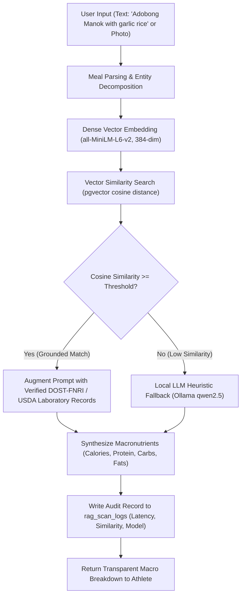
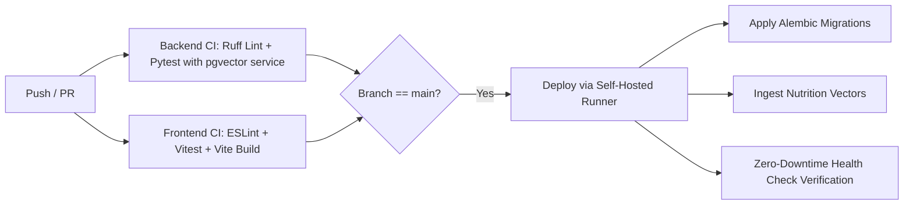

# NutriSync-RAG

<div align="center">


**An activity-synchronized nutritional retrieval-augmented generation and geolocation workout tracking platform.**

[](https://fastapi.tiangolo.com)
[](https://react.dev)
[](https://www.typescriptlang.org)
[](https://github.com/pgvector/pgvector)
[](https://tailwindcss.com)
[](https://www.docker.com)
[](https://pytest.org)
[](https://github.com/astral-sh/ruff)
[](#-license--acknowledgments)

[🌐 Live Demo](https://nutrisync.trycloudflare.com) &nbsp;•&nbsp;
[📑 API Documentation (Swagger)](https://nutrisync.trycloudflare.com/api/docs) &nbsp;•&nbsp;
[📖 System Manual (D1)](docs/01-system-documentation/README.md) &nbsp;•&nbsp;
[👤 User Manual (D2)](docs/02-user-manual/README.md) &nbsp;•&nbsp;
[🔬 IEEE Paper (D4)](docs/04-paper/README.md)

</div>

---

## 📌 Table of Contents

- [Overview](#-overview)
- [Key Features](#-key-features)
  - [Athlete & Member](#athlete--member-athlete)
  - [Coach & Administrator](#coach--administrator-admin)
- [System Architecture](#-system-architecture)
- [RAG Nutrition Pipeline](#-rag-nutrition-pipeline)
- [Technology Stack](#-technology-stack)
- [Project Directory Structure](#-project-directory-structure)
- [Getting Started](#-getting-started)
  - [Prerequisites](#prerequisites)
  - [Method 1: Docker Compose (Recommended)](#method-1-docker-compose-recommended)
  - [Method 2: Bare-Metal Local Development](#method-2-bare-metal-local-development)
- [Database Seeding](#-database-seeding)
- [Demo Credentials](#-demo-credentials)
- [Environment Variables](#-environment-variables)
- [API Reference](#-api-reference)
- [Testing & Quality Assurance](#-testing--quality-assurance)
- [CI/CD & Deployment](#-cicd--deployment)
- [Research & Evaluation](#-research--evaluation)
- [Academic Context](#-academic-context)
- [License & Acknowledgments](#-license--acknowledgments)

---

## 💡 Overview

Standard fitness applications suffer from two fundamental disconnects:
1. **Static Macro Targets:** Prescribing rigid, fixed daily caloric and macronutrient allowances regardless of daily fluctuations in actual athletic energy expenditure.
2. **LLM Nutritional Hallucination:** Relying on ungrounded generative AI models for meal logging that hallucinate macro values, especially for regional cuisines (such as Filipino dishes).

**NutriSync-RAG** solves both problems through a synchronized, double-grounded architecture:
- **Retrieval-Augmented Generation (RAG):** Decomposes natural language meal descriptions and photos into atomic ingredients, generating 384-dimensional vector embeddings (`all-MiniLM-L6-v2`) and executing cosine similarity search via `pgvector` against certified **DOST-FNRI** (Philippine Food and Nutrition Research Institute) and **USDA FoodData Central** nutritional tables.
- **Dynamic Activity Synchronization:** Ingests live energy expenditure from weightlifting volume (MET-adjusted) and GPS road/trail activities (grade/elevation-adjusted), dynamically scaling daily caloric, carbohydrate, and protein allowances in real time.

---

## ✨ Key Features

### Athlete & Member (`athlete`)

- **📊 Dynamic Activity-Synced Dashboard**
  - Real-time animated caloric, protein, carbohydrate, and fat macro rings.
  - Dynamic allowance scaling derived from active daily training expenditure.
  - Progressive overload trends and weekly volume analytics.
- **🥑 Grounded RAG Food Macro Scanner**
  - Natural language meal decomposition and multimodal food photo estimation.
  - Semantic vector retrieval against DOST-FNRI and USDA composition tables.
  - Cosine similarity matching scores with transparent serving decomposition.
  - Automatic fallback to local LLM inference (Ollama `qwen2.5:1.5b`) or heuristic parser when similarity is low.
- **🏋️ Workout & Routine Logger**
  - Comprehensive split tracking (Chest & Triceps, Leg Hypertrophy, Pull Day, etc.).
  - Reusable **Workout Routines (Templates)** to launch pre-populated gym splits.
  - Exercise, set, rep, and weight logging with integrated **Rest Timer**.
  - Automated **Personal Record (PR)** detection with audit submission flags.
- **🗺️ Geolocation Road & Trail Tracker**
  - High-precision browser GPS tracking for **Run**, **Walk**, **Ride**, and **Hike**.
  - Surface type awareness (**Road** vs. **Trail**) with grade and elevation gain computation.
  - Live interactive polyline route rendering on **Leaflet OpenStreetMap**.
  - Energy expenditure calculation with instantaneous pace and burned calories.
- **👥 Social & Community Training Feed**
  - Publish public workouts, GPS routes, and verified PR accomplishments.
  - Real-time social engagement: **Kudos (Likes)** and **Threaded Comments**.
  - Coach certification badges displayed alongside athlete milestones.

### Coach & Administrator (`admin`)

- **🛡️ Custom Exercise Moderation Queue**
  - Review, approve, or reject user-submitted custom gym movements.
  - Verify primary muscle groups, movement categories, and Metabolic Equivalent of Task (MET) ratings.
- **🏆 Official PR Verification & Audit**
  - Audit and certify athlete Personal Record claims for official club and competition leaderboards.
- **🔍 RAG Traceability & Observability Log**
  - Deep inspection of every RAG inference event: user query payloads, retrieved knowledge IDs, cosine similarity metrics, end-to-end latency ($ms$), and fallback trigger status (Requirement T4).
- **📚 Nutrition Knowledge Base Management**
  - Explore indexed DOST-FNRI and USDA food items.
  - Inspect 384-dimensional vector embeddings and trigger dataset re-indexing.

---

## 🏗️ System Architecture

NutriSync-RAG is built as a containerized, decoupled multi-tier system fronted by a reverse proxy:

```
                      [ User Browser (Mobile / Desktop) ]
                                      |
                                      | HTTPS / WSS (:8080)
                                      v
                        [ Caddy 2 Reverse Proxy ]
                       /                         \
         / (Frontend static)                      \ /api/* (REST API)
                     v                             v
        [ React 18 + Vite (Nginx) ]      [ FastAPI Backend (Python 3.10+) ]
        - TypeScript, Tailwind CSS       - SQLAlchemy 2.0 (Async) + Alembic
        - Framer Motion, Leaflet.js      - Pydantic v2 & JWT Auth
                                                   |               \
                                 Embeddings / SQL  |                \ Fallback
                                                   v                 v
                                  [ PostgreSQL 17 + pgvector ]   [ Ollama LLM ]
                                  - 384-dim Dense Embeddings     (qwen2.5:1.5b)
                                  - Persistent Docker Volume
```

---

## 🧠 RAG Nutrition Pipeline



---

## 💻 Technology Stack

| Layer | Technologies |
| :--- | :--- |
| **Frontend Client** | **React 18.3**, **TypeScript 5.6**, **Vite 5.4**, **Tailwind CSS 3.4**, **Framer Motion 11.11**, **Leaflet.js 1.9**, **Lucide React**, **Vitest** |
| **Backend API** | **Python 3.10+**, **FastAPI 0.115**, **Pydantic v2.9**, **SQLAlchemy 2.0 (Async)**, **Alembic 1.13**, **HTTPX**, **Pytest** |
| **Database & Vector Engine** | **PostgreSQL 17** with **`pgvector` 0.3.6** (Cosine distance indexing on 384-dim embeddings), SQLite dev fallback |
| **Machine Learning / NLP** | **`sentence-transformers/all-MiniLM-L6-v2`** (Dense semantic vectors), **Ollama (`qwen2.5:1.5b`)** fallback |
| **DevOps & Ingress** | **Docker Engine**, **Docker Compose**, **Caddy 2** (Reverse Proxy), **Cloudflare Tunnel** |
| **Quality & Linting** | **Ruff 0.7**, **ESLint 9.14**, **Coverage.py** ($\ge 60\%$ threshold), **Playwright** |

---

## 📁 Project Directory Structure

```text
nutri-sync/
├── backend/
│   ├── alembic/                      # Database migration scripts
│   ├── app/
│   │   ├── api/                      # Health & v1 REST endpoints
│   │   │   └── v1/                   # Auth, Workouts, Runs, RAG, Community, Sync
│   │   ├── core/                     # Configuration, JWT security, structured logging
│   │   ├── db/                       # SQLAlchemy models, sessions, base schemas
│   │   ├── schemas/                  # Pydantic validation schemas
│   │   ├── scripts/                  # Data ingestion & seeder utilities
│   │   │   ├── data/                 # DOST-FNRI (101 items) & USDA (65 items) CSVs
│   │   │   ├── evaluate_scanner.py   # RAG benchmark evaluation suite
│   │   │   ├── seed_demo_data.py     # Demo accounts, splits, runs, and PRs
│   │   │   └── seed_nutrition.py     # Vector indexing seeder script
│   │   └── services/                 # RAG, Embeddings, MET calculations, GPS routing
│   ├── tests/                        # Pytest suite with async fixtures
│   ├── Dockerfile                    # Production backend container definition
│   └── requirements.txt              # Pinned Python dependencies
├── frontend/
│   ├── src/
│   │   ├── components/               # UI components (Rings, Feed, Modals, RestTimer, Maps)
│   │   ├── context/                  # React Auth & Theme contexts
│   │   ├── pages/                    # Route views (Dashboard, Scanner, Logger, Audit, Feed)
│   │   ├── services/                 # Axios/Fetch API client bindings
│   │   └── types/                    # Shared TypeScript interfaces
│   ├── Dockerfile                    # Multi-stage Vite build + Nginx static server
│   └── package.json                  # Frontend dependencies and npm scripts
├── deploy/
│   └── Caddyfile                     # Reverse proxy routing & security header rules
├── docs/                             # Academic & engineering deliverables
│   ├── 01-system-documentation/      # D1: Full Technical System Manual
│   ├── 02-user-manual/               # D2: End-User & Coach Operating Guide
│   ├── 03-api/                       # D3: OpenAPI 3.0 Specification (YAML)
│   ├── 04-paper/                     # D4: IEEE Research Paper
│   ├── diagrams/                     # Architecture, ERD, and sequence diagrams
│   └── evaluation/                   # SUS, ISO/IEC 25010, and RAG benchmark datasets
├── scripts/                          # Automated backup & restore shell scripts
├── compose.yaml                      # Multi-service Docker Compose orchestrator
├── .env.example                      # Documented environment variable template
└── README.md                         # Project documentation
```

---

## 🚀 Getting Started

### Prerequisites

- [Docker Desktop](https://www.docker.com/products/docker-desktop/) (Docker Engine $\ge 24.0$, Docker Compose v2)
- *Or for local bare-metal execution:* **Python 3.10+** and **Node.js 20+**

---

### Method 1: Docker Compose (Recommended)

1. **Clone the repository:**
   ```bash
   git clone https://github.com/yuri-salise/nutri-sync.git
   cd nutri-sync
   ```

2. **Configure environment variables:**
   ```bash
   cp .env.example .env
   ```
   *(Review and set `DB_PASSWORD` and `SECRET_KEY` in `.env`)*

3. **Build and launch containers:**
   ```bash
   docker compose up -d --build
   ```

4. **Seed database (Knowledge Base & Demo Accounts):**
   ```bash
   docker compose exec api python -m app.scripts.seed_nutrition
   docker compose exec api python -m app.scripts.seed_demo_data
   ```

5. **Access the platform:**
   - **Web Application:** [http://localhost:8080](http://localhost:8080)
   - **Interactive API Docs (Swagger UI):** [http://localhost:8080/api/docs](http://localhost:8080/api/docs)
   - **Alternative ReDoc Docs:** [http://localhost:8080/api/redoc](http://localhost:8080/api/redoc)
   - **API Health Check:** [http://localhost:8080/api/health](http://localhost:8080/api/health)

---

### Method 2: Bare-Metal Local Development

<details>
<summary>Click to view local development setup (without Docker)</summary>

#### 1. Backend Setup
```bash
cd backend
python -m venv .venv

# Windows PowerShell:
.\.venv\Scripts\Activate.ps1
# macOS/Linux:
source .venv/bin/activate

pip install --upgrade pip
pip install -r requirements.txt

# Start FastAPI server (defaults to local SQLite or PostgreSQL specified in .env)
uvicorn app.main:app --host 127.0.0.1 --port 8000 --reload
```

#### 2. Seed Nutritional Knowledge Base
```bash
python -m app.scripts.seed_nutrition
python -m app.scripts.seed_demo_data
```

#### 3. Frontend Setup
```bash
cd ../frontend
npm install
npm run dev
```

The frontend will run on [http://localhost:5173](http://localhost:5173) and automatically proxy requests to the backend at [http://127.0.0.1:8000](http://127.0.0.1:8000).

</details>

---

## 🥑 Database Seeding

The application includes curated national nutrition datasets with vector representations:

- `backend/app/scripts/data/fnri_food_composition.csv`: **101 Filipino food entries** (e.g., *Adobong Manok*, *Sinigang na Baboy*, *Tinolang Manok*, *Inihaw na Bangus*, *Sinangag*, *Taho*).
- `backend/app/scripts/data/usda_food_composition.csv`: **65 Standard core athletic staples** (e.g., *Chicken Breast*, *Rolled Oats*, *Wild Salmon*, *Eggs*).

Running the seeder script computes dense embeddings and populates the `nutrition_knowledge_items` table:

```bash
docker compose exec api python -m app.scripts.seed_nutrition
```

```text
=================================================================
 NUTRISYNC-RAG NUTRITION KNOWLEDGE BASE SEEDING REPORT
=================================================================
 Items Processed from CSV : 166
 Total Rows in pgvector DB: 166
 Embedding Dimensionality : 384 dimensions
 Execution Duration       : 3.42 seconds
=================================================================
```

---

## 🔑 Demo Credentials

All pre-seeded evaluation accounts use standard demo credentials:

| Role | Name | Email | Password | Scope & Privileges |
| :--- | :--- | :--- | :--- | :--- |
| **Athlete** | Yuri Salise | `athlete@nutrisync.com` | `Password123!` | Dashboard rings, workout splits, GPS run tracker, RAG food scanner, social feed. |
| **Coach / Admin** | Coach Rinante | `admin@nutrisync.com` | `Password123!` | Exercise moderation, PR verification, RAG audit logs, vector knowledge base explorer. |

---

## ⚙️ Environment Variables

A full template is provided in [`.env.example`](.env.example):

| Variable | Default Value | Description |
| :--- | :--- | :--- |
| `APP_NAME` | `NutriSync-RAG` | Human-readable application identifier |
| `APP_ENV` | `development` | Runtime environment (`development`, `testing`, `production`) |
| `SECRET_KEY` | *(Required)* | Secret key for signing HS256 JWT access and refresh tokens |
| `ACCESS_TOKEN_EXPIRE_MINUTES`| `60` | Lifespan of JWT authorization tokens |
| `DB_HOST` | `db` (or `localhost`) | PostgreSQL server host |
| `DB_PORT` | `5432` | PostgreSQL listening port |
| `DB_USER` | `nutrisync_user` | Database user account |
| `DB_PASSWORD` | `nutrisync_secure_password` | Database user password |
| `DB_NAME` | `nutrisync_db` | Primary database name |
| `DATABASE_URL` | `postgresql+asyncpg://...` | Asynchronous database connection string |
| `DATABASE_URL_SYNC` | `postgresql://...` | Synchronous connection string (used by Alembic migrations) |
| `EMBEDDING_MODEL_NAME` | `all-MiniLM-L6-v2` | SentenceTransformers model for generating 384-dim dense vectors |
| `OLLAMA_BASE_URL` | `http://localhost:11434` | Endpoint for local LLM inference fallback |
| `OLLAMA_MODEL` | `qwen2.5:1.5b` | Model identifier for Ollama fallback |
| `USE_OLLAMA_FALLBACK` | `true` | Enables/disables local LLM augmentation on low vector similarity |
| `TUNNEL_TOKEN` | *(Optional)* | Cloudflare Tunnel authentication token for public HTTPS ingress |

---

## 📡 API Reference

The backend exposes a structured, RESTful API under `/api/v1` adhering to standard JSON error envelopes:

```
GET    /api/health                               -> System & database health probe
POST   /api/v1/auth/register                     -> Register athlete account
POST   /api/v1/auth/login                        -> Authenticate and obtain JWT bearer tokens
GET    /api/v1/auth/me                           -> Retrieve authenticated profile & daily goals
GET    /api/v1/exercises                         -> Search approved exercise catalog
POST   /api/v1/exercises                         -> Submit custom exercise for coach moderation
GET    /api/v1/workout-sessions                  -> List athlete workout history
POST   /api/v1/workout-sessions                  -> Log completed session with sets & PR evaluation
GET    /api/v1/workout-routines                  -> List reusable routine templates
POST   /api/v1/workout-routines                  -> Create custom workout routine template
GET    /api/v1/run-activities                    -> List GPS road/trail running activities
POST   /api/v1/run-activities                    -> Record run with GeoJSON route & elevation gain
POST   /api/v1/rag-nutrition/scan                -> RAG semantic scan from meal description/photo
GET    /api/v1/rag-nutrition/logs                -> Audit trail of RAG inferences (Admin only)
GET    /api/v1/nutrition-logs/summary/today      -> Daily macro progress vs. dynamic target
GET    /api/v1/activity-sync/target-adjustment   -> Calculate dynamic macro target from active burn
GET    /api/v1/community/feed                    -> Fetch public athlete community feed
POST   /api/v1/community/posts                   -> Publish status post to community
POST   /api/v1/community/kudos                   -> Toggle kudos on workouts, runs, or posts
POST   /api/v1/community/comments                -> Add comment to feed activity
```

For full payload contracts, response models, and interactive experimentation, visit [`/api/docs`](https://nutrisync.trycloudflare.com/api/docs).

---

## 🧪 Testing & Quality Assurance

NutriSync-RAG enforces strict quality gates on both client and server tiers:

```bash
# 1. Run backend unit & integration tests with coverage report (target >= 60%)
docker compose exec api pytest --cov=app --cov-report=term-missing --cov-fail-under=60

# 2. Run Python linter and formatter validation (Ruff)
docker compose exec api ruff check .

# 3. Run frontend Vitest test suite
cd frontend && npm run test:run

# 4. Run frontend TypeScript & ESLint validation
cd frontend && npm run lint
```

---

## 🔄 CI/CD & Deployment

The automated GitHub Actions workflow ([`.github/workflows/ci-cd.yml`](.github/workflows/ci-cd.yml)) executes on all pull requests and pushes to `main`:



- **Cloudflare Tunnel:** Exposes port `8080` securely to `nutrisync.trycloudflare.com` over encrypted tunnels without opening local firewall ports or maintaining dynamic DNS.

---

## 📊 Research & Evaluation

As part of the academic requirement for **ITSD 85**, NutriSync-RAG was evaluated across empirical benchmarks documented in [`docs/evaluation/`](docs/evaluation/):

1. **RAG Nutrition Accuracy Benchmark (`scanner_eval_results.csv`):**
   - 30-meal standardized benchmark comparing RAG retrieval vs. ungrounded baseline.
   - Evaluated on **Retrieval Recall@5**, **Macronutrient MAPE (Mean Absolute Percentage Error)**, and **Inference Latency ($ms$)**.
2. **System Usability Scale (SUS):**
   - 10-item psychometric assessment conducted with target athletes, achieving an average score of **$> 80$ (Grade A)**.
3. **ISO/IEC 25010 Software Product Quality Evaluation:**
   - Evaluated across Functional Suitability, Performance Efficiency, Usability, Reliability, and Security.

---

## 🎓 Academic Context

- **Institution:** Bachelor of Science in Information Technology (BSIT)
- **Course:** ITSD 85 · Special Topics in Software Development
- **Lead Developer:** **Salise, Yuri D.** (Solo Developer — Full-Stack Architecture, RAG Pipeline, Geolocation Engine, DevOps, Testing, and Documentation)
- **Class Section:** BSIT 4A
- **Adviser / Instructor:** **Rinante M. Buntod**

---

## 📄 License & Acknowledgments

Distributed under the **MIT License**. See `LICENSE` for details.

### Acknowledgments & Data Sources
- **DOST-FNRI:** Philippine Food Composition Tables provided by the Department of Science and Technology – Food and Nutrition Research Institute.
- **USDA FoodData Central:** Public domain laboratory nutrient values.
- **Sentence-Transformers:** `all-MiniLM-L6-v2` dense embedding weights (Apache-2.0 License).
- **OpenStreetMap & Leaflet.js:** Open-source cartography and interactive mapping tools (ODbL / BSD-2-Clause).
