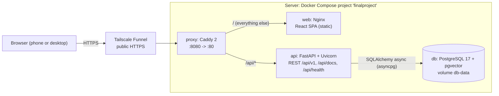
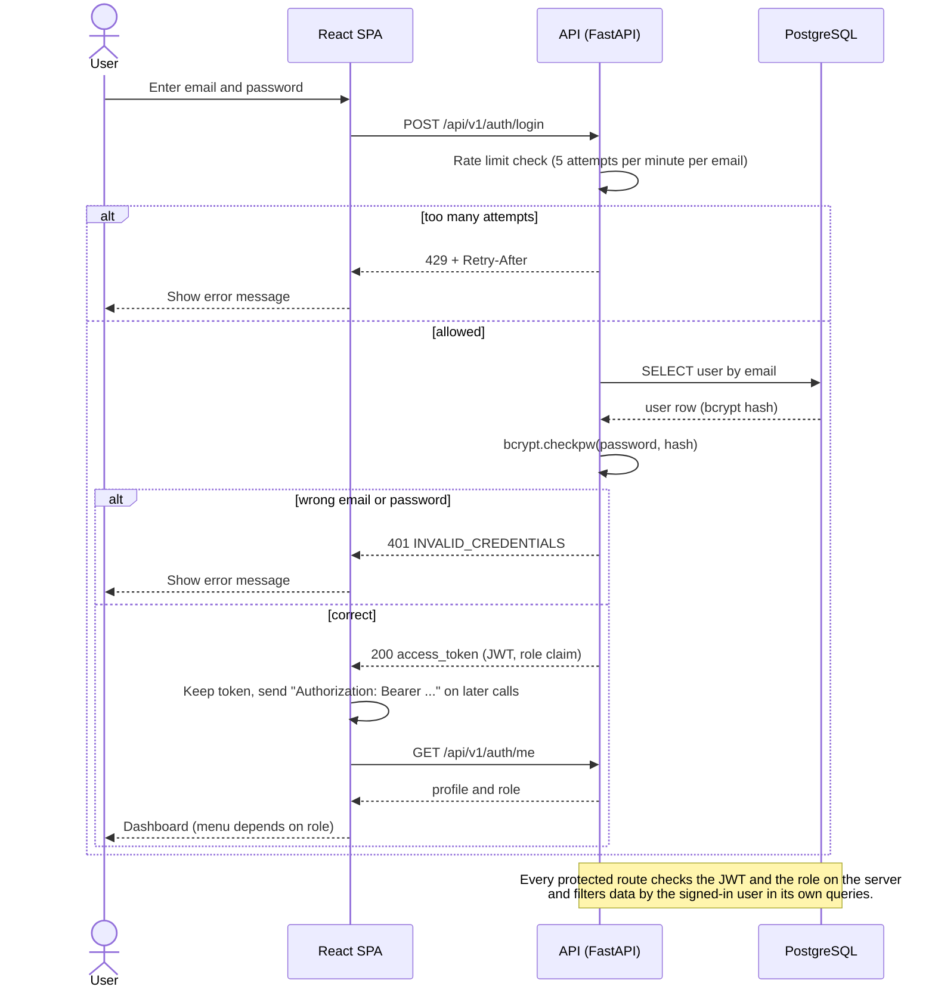
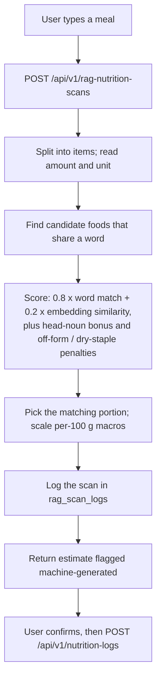

# Chapter 4 (draft): System design

Everything here was checked against the code on 2026-11-18. Diagram sources are in [`docs/diagrams/`](../diagrams/).

## 4.1 Architecture

*Figure 4.1. Architecture and deployment.* The same drawing is the deployment diagram: four containers started by one `docker compose up -d`, public HTTPS provided by Tailscale Funnel on the host, and Caddy routing `/api/*` to the API and everything else to the static frontend.

The browser talks only to the REST API; it never reaches the database and never holds model files or service keys (requirements F1, T2).

## 4.2 Database design

- PostgreSQL 17 with the `pgvector` extension; 13 tables, created by Alembic migrations `001` to `005` in `backend/alembic/versions/`.
- The ER diagram is generated from the models: [generated/erd.md](generated/erd.md). The full data dictionary (every column, type, key and constraint) is [generated/data-dictionary.md](generated/data-dictionary.md).
- Main groups: users; workouts (`workout_sessions`, `workout_sets`, `exercises`, `workout_routines`, `workout_routine_exercises`); GPS activities (`run_activities`); nutrition (`nutrition_knowledge_items`, `nutrition_logs`, `rag_scan_logs`); social (`feed_posts`, `kudos`, `feed_comments`).
- `nutrition_knowledge_items` holds the food tables (101 FNRI and 7,793 USDA rows) with per-100 g macros, a default serving, all household portions in `portions`, and a 384-dimension `embedding` column.
- Data persists in the Docker volume `db-data` (requirement DP6).

## 4.3 API design summary

- Base path `/api/v1`; JSON only; resources are plural nouns; standard methods and status codes (201 for create, 204 for delete, 401, 403, 404, 409, 422, 429).
- Lists return `{ "data": [...], "meta": { "page", "limit", "total", "total_pages" } }`.
- Errors always use `{ "error": { "code", "message", "details": [...] } }`.
- Live interactive documentation at `/api/docs`; machine-readable [openapi.yaml](../03-api/openapi.yaml) (43 operations); list in [generated/endpoints.md](generated/endpoints.md).

## 4.4 Security design

*Figure 4.2. Login sequence.* Source: [auth_login_sequence.mmd](../diagrams/auth_login_sequence.mmd).

| Topic | Design |
| :--- | :--- |
| Passwords | bcrypt with a per-password salt; never logged or returned. |
| Tokens | JWT (HS256) signed with `SECRET_KEY`; access token valid 60 minutes, with a `role` claim. |
| Roles | `athlete` and `admin` (shown as "Coach" in the UI). Registration ignores a requested `admin` role (test `test_register_cannot_self_assign_admin`). |
| Authorization | Each protected endpoint checks the token and the role on the server and filters data by the signed-in user. The coach can verify PRs and review logs; athletes cannot. |
| Login rate limit | 5 attempts per minute per email; the 6th gets `429` with `Retry-After`. **Limit:** held in memory per process, so it resets on restart and is not per IP. |
| CORS | Only the origin in `FRONTEND_ORIGIN` (set from the public URL). |
| Secrets | `.env` is git-ignored; the server keeps one secrets file outside the repository, copied at deploy time. |
| Row-level security | Policies were written in migration `002`, but they are **not effective in production**: the application connects as the database's own superuser, which bypasses them, and only the community endpoints set the context the policies read. Protection comes from the per-endpoint checks above. Making the policies effective needs a non-superuser application role, `FORCE ROW LEVEL SECURITY` and setting the context on every request; this is a known gap. |
| Logging | One line per request (method, path, status, duration, client IP). No request bodies, passwords or tokens. |

## 4.5 Design of the technology integration (meal scanner)

The full flow, including the fallback branch, is in [rag_pipeline_dataflow.mmd](../diagrams/rag_pipeline_dataflow.mmd).

*Figure 4.3. Data flow of the scanner.*

- **What "retrieval-augmented" means here:** the system retrieves the closest rows from the FNRI and USDA tables and computes macros from those rows. No language model writes numbers, so every number traces to a food-table row.
- **Fallback (T3):** if the neural embedding library is not installed (the default in the Docker image), a deterministic 384-dimension hash embedding is used and `used_fallback` is recorded. Matching itself runs in Python over the knowledge-base rows; the stored `pgvector` column is not used for the search.
- **Confidence:** scores of at least 0.60 are "high", 0.40 to 0.59 "low"; below 0.40 the item is reported as not found, contributes no calories and is listed so the user can add it manually.
- **Traceability (T4):** each scan writes a row to `rag_scan_logs` (user, input, retrieved food IDs, top score, predicted macros, matcher version, latency, fallback flag, timestamp). Coaches can browse these rows.
- **Human confirmation (T6):** the response carries `is_machine_generated` and `requires_human_confirmation`; the UI lets the user edit grams and remove items before saving.
- **Photo input:** `image_base64` in the same request. `vision_service.py` asks Gemini and then Groq (free tiers, keys only on the server) to name each food and estimate grams; that text goes through the same matcher, so all macros still come from the tables. With no key configured the API returns `503` with a clear message, and the screen asks the user to type the meal. No key is configured on the deployed server at the time of writing.

## 4.6 UI design

Ten screens, listed in the [traceability chapter](03-requirements-traceability.md). Screenshots of the deployed version are in the [user manual](../02-user-manual/README.md). The wireframes-versus-final comparison is **[PEOPLE]**: no wireframes are stored in the repository.
