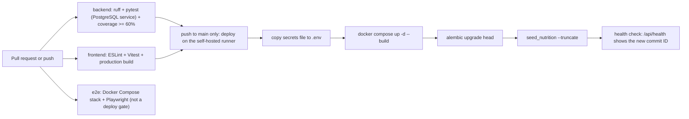

# Chapter 7 (draft): Deployment and operations

## 7.1 Infrastructure

| Part | What it is |
| :--- | :--- |
| Host | The team's own Windows PC running WSL2 (Ubuntu) and Docker Desktop. No paid cloud. |
| Containers | Compose project `finalproject`: `db` (PostgreSQL 17 + pgvector, volume `db-data`), `api` (FastAPI), `web` (Nginx with the built React app), `proxy` (Caddy, published on port 8080). |
| Public HTTPS | Tailscale Funnel forwards the public HTTPS address to `localhost:8080`. |
| CI/CD runner | A GitHub Actions self-hosted runner in WSL with labels `self-hosted`, `linux`, `deploy`. |

**Dependency to state plainly:** the system is only reachable while the PC is on and WSL, Docker Desktop, Tailscale and the runner are running. The runner must be installed as a service (`sudo ./svc.sh install && sudo ./svc.sh start` inside `~/actions-runner`) so it starts with WSL; this needs the server user's `sudo` password and has to be done on the machine.

## 7.2 CI/CD pipeline



*Figure 7.1. Pipeline.* Workflow file: `.github/workflows/ci-cd.yml`. A screenshot of a green run must be added to the submitted document **[PEOPLE]**.

## 7.3 Environment variables (names only)

Defined in `.env.example`: `APP_NAME`, `APP_VERSION`, `API_V1_PREFIX`, `SECRET_KEY`, `ACCESS_TOKEN_EXPIRE_MINUTES`, `REFRESH_TOKEN_EXPIRE_DAYS`, `DB_USER`, `DB_PASSWORD`, `DB_NAME`, `DATABASE_URL`, `DATABASE_URL_SYNC`, `FRONTEND_ORIGIN`, `PUBLIC_APP_URL`, `EMBEDDING_MODEL_NAME`, `LOGIN_RATE_LIMIT`, `GEMINI_API_KEY`, `GEMINI_VISION_MODEL`, `GROQ_API_KEY`, `GROQ_VISION_MODEL`. On Vercel, also `DB_SERVERLESS` (see `deploy/VERCEL_SUPABASE.md`).

On the server these live in one file outside the repository (`/home/deploy/secrets/finalproject.env`, owner-only permissions). The deploy copies it to `.env` in the workspace. It is never committed.

## 7.4 Deploy procedure

Automatic: merge or push to `main`. The deploy job builds the images, starts the containers, applies migrations, reloads the food tables (`seed_nutrition --truncate`, so they never duplicate) and waits until `/api/health` reports the new commit ID.

Manual (if the runner is down): on the server, from the workspace folder, run `docker compose -p finalproject up -d --build`, then `docker compose -p finalproject exec -T api alembic upgrade head`.

## 7.5 Rollback procedure

1. Find the last good commit (green run on `main`).
2. Revert the bad change with `git revert <sha>` and push; the pipeline redeploys the previous behaviour. (Re-running the workflow of the old commit also works.)
3. If the bad release added a migration that must be undone, run `docker compose -p finalproject exec -T api alembic downgrade -1` **before** deploying the older code, after taking a backup.
4. Confirm `/api/health` shows the expected commit ID.

## 7.6 Backup and restore (requirement D4)

Scripts: `deploy/backup.sh` and `deploy/restore.sh`.

```bash
# Back up (writes ~/backups/db_<date>.sql and keeps the newest 14)
COMPOSE_DIR=<folder with compose.yaml and .env> bash deploy/backup.sh ~/backups

# Daily at 02:00 with cron (add with `crontab -e`)
0 2 * * * COMPOSE_DIR=<folder> bash <repo>/deploy/backup.sh ~/backups

# Restore test: loads into a scratch database "<DB_NAME>_restore_test", prints row counts
# next to the live ones, then drops the scratch database
COMPOSE_DIR=<folder> bash deploy/restore.sh ~/backups/db_<date>.sql --drop-after

# Real restore after a disaster: stop the api container, restore into an empty database
# with the real name, then start the api again
COMPOSE_DIR=<folder> bash deploy/restore.sh ~/backups/db_<date>.sql <empty_database_name>
```

Dumps contain user data. They stay on the server (`*.sql` is git-ignored) and files are created readable by the owner only. **Limits:** backups are on the same machine as the database, so a disk failure loses both; copy them elsewhere regularly. The cron entry above is a recommendation and has **not** been installed.

### Restore test record

| Item | Value |
| :--- | :--- |
| Date | 2026-11-17, about 23:35 (server local time) |
| Backup file | `db_2026-11-17_233536.sql`, 10,733,203 bytes, made from the live database |
| Restored into | scratch database `nutrisync_db_restore_test` (dropped afterwards) |
| Rows checked (restored / live) | users 2 / 2; nutrition_knowledge_items 7,894 / 7,894; workout_sessions 1 / 1; run_activities 1 / 1; rag_scan_logs 12 / 12 |
| Schema version in the restored copy | `005_food_portions` |
| Result | Passed: every checked count matched; no errors. |

## 7.7 Monitoring

`GET /api/health` returns status, version (commit ID) and database connectivity, and returns 503 when the database is down. Container logs: `docker compose -p finalproject logs --tail 100 api`. There is no external monitoring or alerting.

## 7.8 Known issues

- Availability depends on one PC (see 7.1). The runner is currently started by hand unless installed as a service.
- Row-level security policies exist but are bypassed (see chapter 4); access control relies on the checks in each endpoint.
- The login rate limit is in memory per process.
- No branch ruleset on `main` (requirement DP5).
- Backups are not copied off the machine and are not scheduled yet.
- Demo account passwords are public in the README; do not store real data in those accounts.
- The `Account Role` drop-down on the registration form offers "Coach / Admin", but the server ignores it and always creates an athlete.
