# D2: User Manual (draft)

**NutriSync-RAG**: log workouts, record GPS activities, and estimate the nutrition of a meal by typing what you ate.

> **Status.** The steps and screenshots below are real and use the demo accounts only (sample data). The guidelines also ask for the school page layout (10 to 25 pages, PDF). Retake the screenshots in `images/` from the final deployed site with `npm run screenshots` in the `e2e/` folder before exporting the PDF. Password reset is not available in the app.

## 1. Introduction

NutriSync-RAG helps athletes keep training and eating in one place.

- **Athletes** log strength workouts, record runs, walks, rides and hikes with GPS, estimate meals, keep a food log, and see a daily calorie target that follows their activity.
- **Coaches** (administrators) manage the built-in exercise library, review the meal-scanner history, browse the food database and moderate the community feed.

Meal results are **estimates made by a computer** from food tables. Check them before you save.

## 2. Getting started

**Address:** the public HTTPS address given in the project README. It works in current Chrome, Edge, Firefox and Safari, on a phone or a computer. The site is available only while the host computer is running.

**Create an account.** Open **Register**, enter your name, email, a password of at least 8 characters (twice), your weight and daily calorie goal, then press **Complete Profile & Launch**. New accounts are always athletes, even though the form shows an "Account Role" menu.

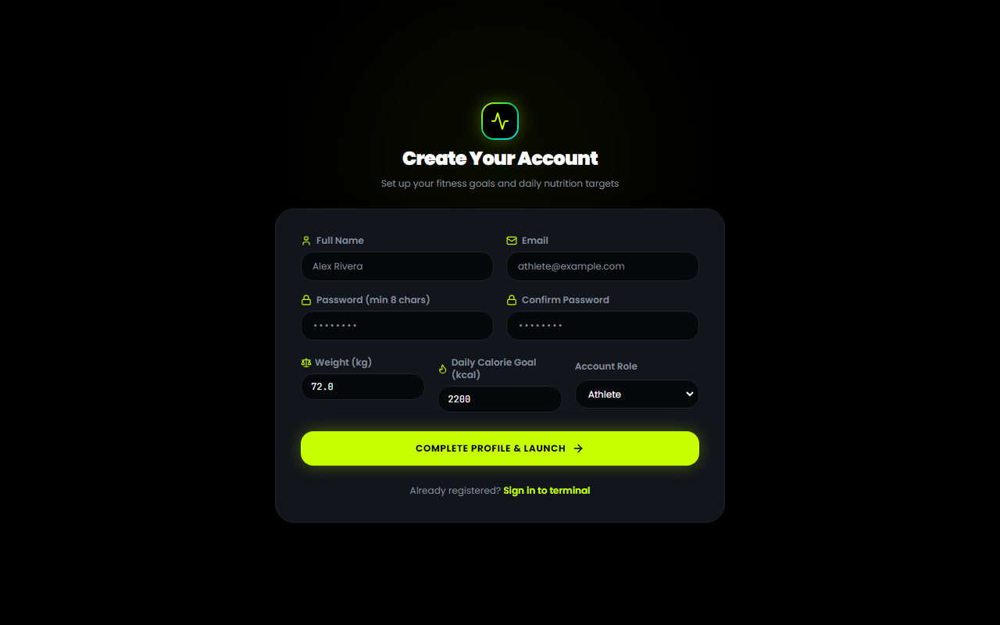

**Sign in.** Enter your email and password and press **Sign In to Account**. After 5 wrong attempts in a minute you must wait a minute before trying again.

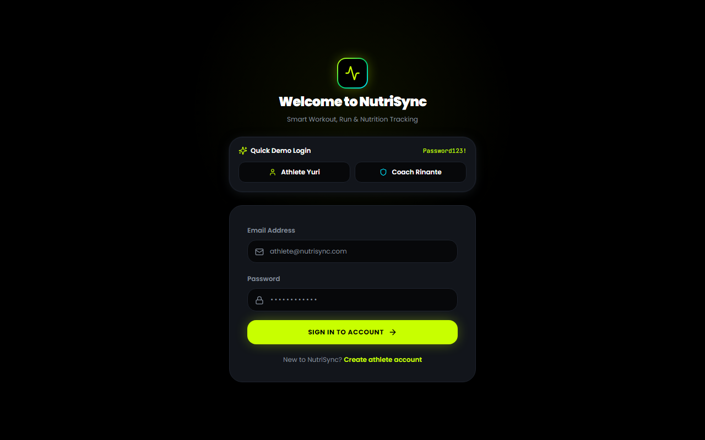

**Demo accounts** (sample data only):

| Role | Email | Password |
| :--- | :--- | :--- |
| Athlete | `athlete@nutrisync.com` | `Password123!` |
| Coach | `admin@nutrisync.com` | `Password123!` |

The "Demo: Athlete / Coach" switch at the top of the page signs you in as either one.

**On a phone.** Every page works at 360 px wide, and the main menu is at the bottom of the screen.

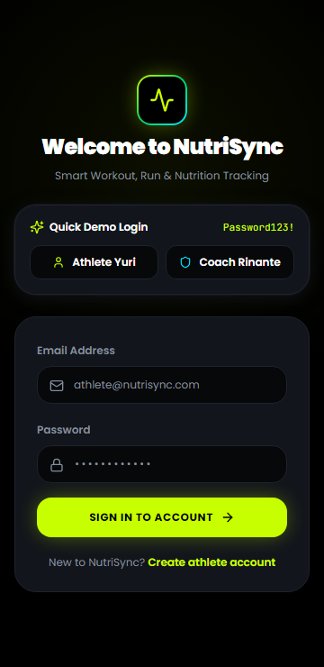

## 3. Athlete guide

### 3.1 Dashboard

The first page after signing in shows your calorie and macro targets for today, adjusted for the activity you recorded.

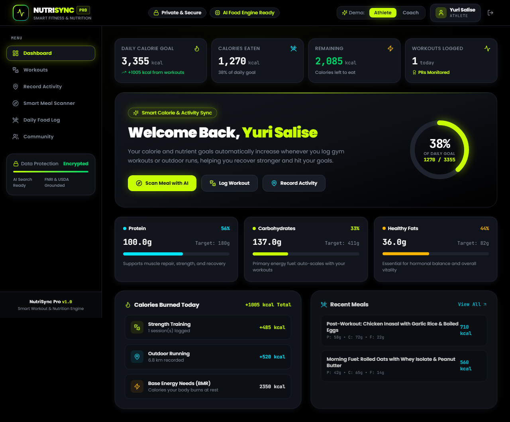

### 3.2 Log a workout

1. Open **Workouts**.
2. Pick an exercise, or start from a saved routine.
3. Add sets with weight and repetitions; the page shows what you lifted last time.
4. Finish the workout. The heaviest set for an exercise in that workout is marked as a **personal record**.

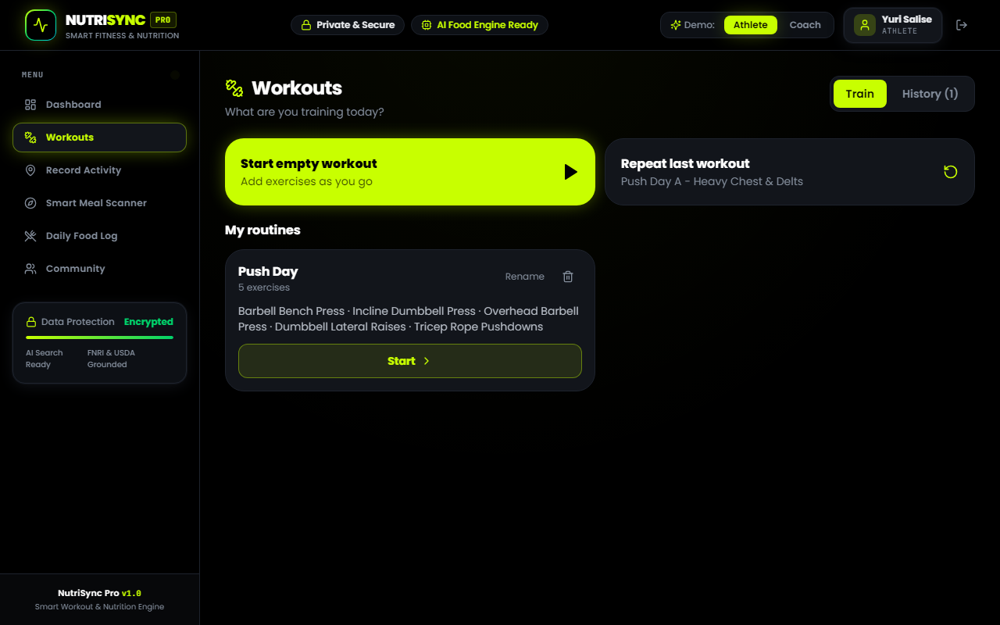

### 3.3 Record and review activities

1. Open **Record Activity**, choose Run, Walk, Ride or Hike, and press start. Allow location access when the browser asks.
2. Pause or stop when you finish, name the activity, and choose whether to share it with the community.
3. Your activities are listed below the recorder. **Select one to open its detail page**: route, distance, time, pace or speed, elevation gain and estimated energy.
4. On the detail page you can delete your own activity (you are asked to confirm).

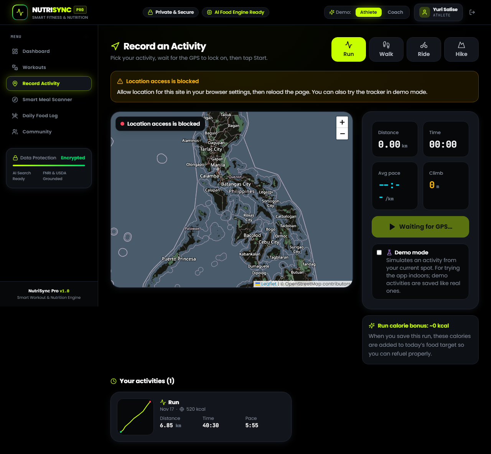

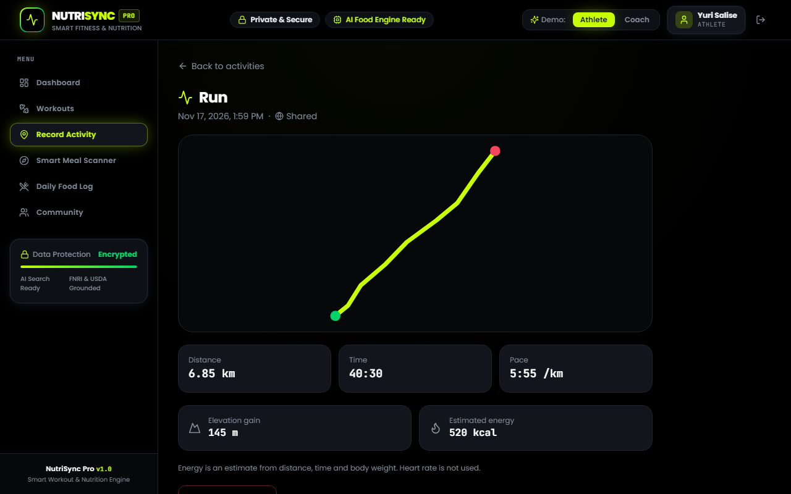

Energy is estimated from distance, time and body weight. Heart rate is not used.

### 3.4 Estimate a meal (Smart Meal Scanner)

1. Open **Smart Meal Scanner**.
2. Type what you ate, in English or Tagalog, with amounts if you know them: `chicken adobo with 1 cup rice and a boiled egg`, `200g grilled chicken breast`, `2 pandesal and 1 cup oatmeal`. Press **Analyze meal**.
3. The page lists each food it found, the amount in grams and the calories. Change the grams, or remove a food that is wrong. Foods it could not find are listed separately and add nothing.
4. Read the totals. A note reminds you that this is a machine-generated estimate.
5. Press **Looks right — save to food log** to save it.

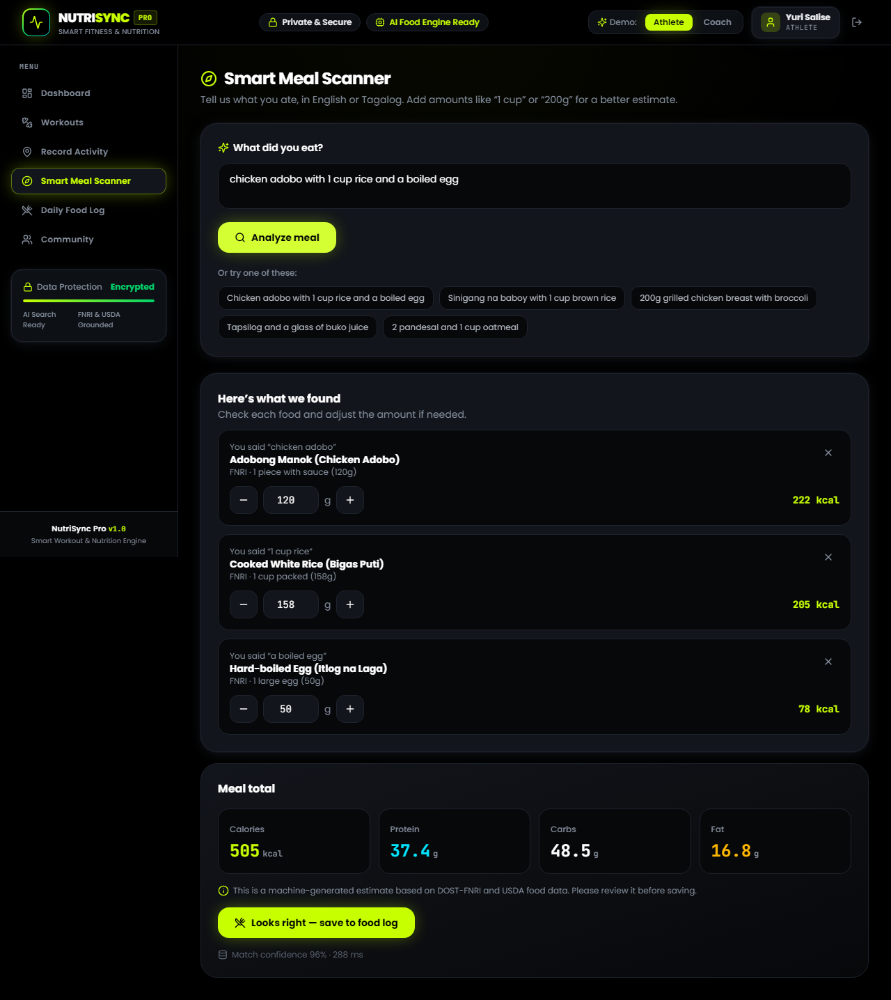

**Photo (when the host has enabled it).** Press **Take or upload a photo**, add an optional note, and press **Analyze meal**. A vision model names the foods and guesses the amounts; the page then shows the same editable list. When the analysis finishes, a green message at the top of the results says "Photo analyzed" and how many foods were found. Photo amounts are rough guesses, so check the grams. If the host has not set it up, you will see "Photo analysis is not configured on this server" and can type your meal instead.

**Photo and note together.** What you type counts more than what the photo shows:

- Amounts you type replace the amounts guessed from the photo (`1 cup rice`, `I only had 120g adobo`).
- Foods you name are added even if they are not in the photo (`plus a glass of buko juice`).
- Foods you say you did not eat are left out (`no egg`).
- If the photo cannot be read, or shows no food, your typed meal is analyzed instead and a yellow message tells you so.

Tips: write amounts like `1 cup`, `200g`, `3 oz` or `2 slices`. If you give no amount, one standard serving is assumed. Foods that are not in the Philippine or USDA tables will not be found.

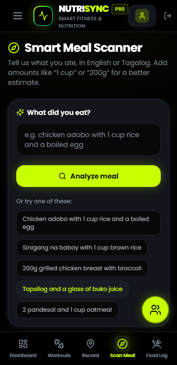

### 3.5 Food log

**Daily Food Log** lists the meals you saved with your totals. You can add a meal by hand (title, calories, protein, carbs, fat) and delete meals you no longer want.

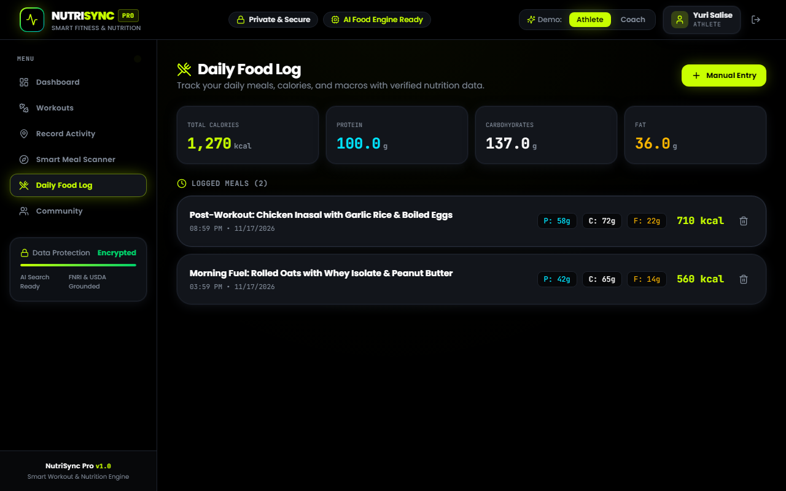

### 3.6 Community

The feed shows public workouts, activities and posts, newest first. Filter by type, give kudos, comment, or share a short post. Private items never appear here.

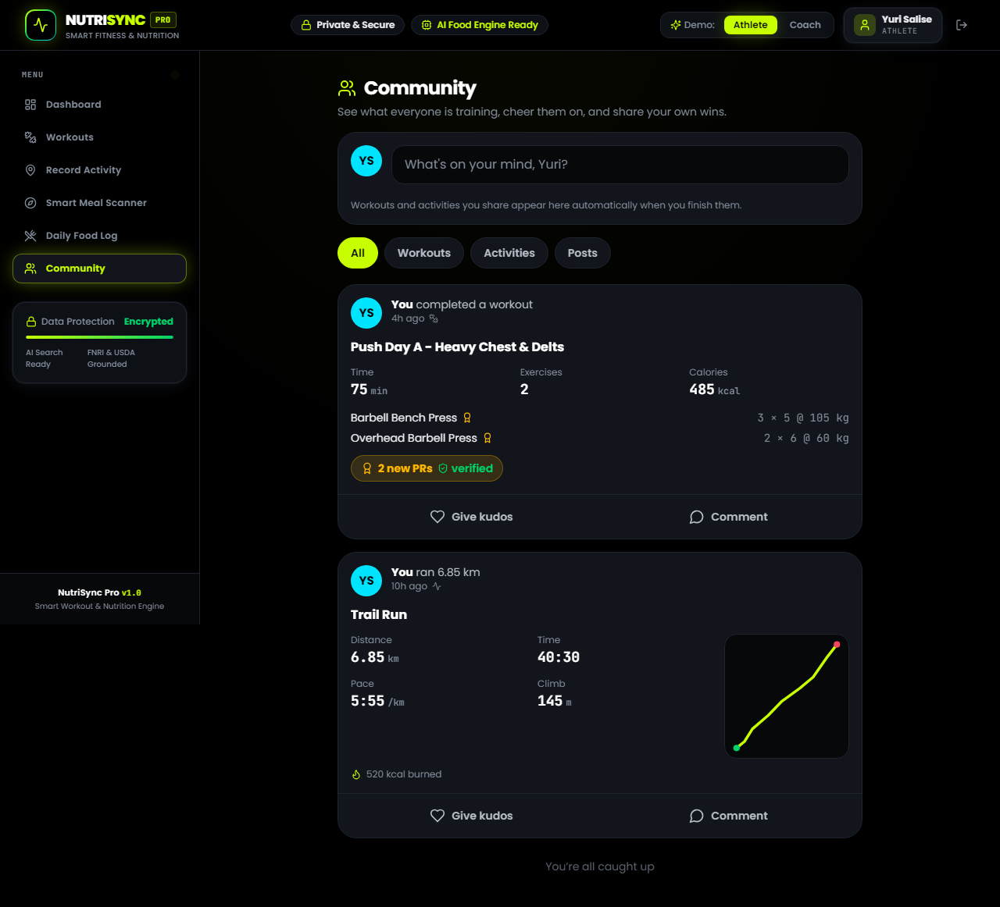

## 4. Coach / administrator guide

Sign in with a coach account. A **Coach Dashboard** item appears in the menu. It has these tabs:

1. **Exercise library:** search and manage the built-in exercises everyone can use.
2. **Meal scan history:** every meal estimate with its input, score, time taken and whether the fallback was used.
3. **Food database:** search the Philippine (FNRI) and USDA foods the scanner uses.
4. **Info:** a short explanation of how the scanner works.

Coaches can also delete any post in the Community feed for moderation.

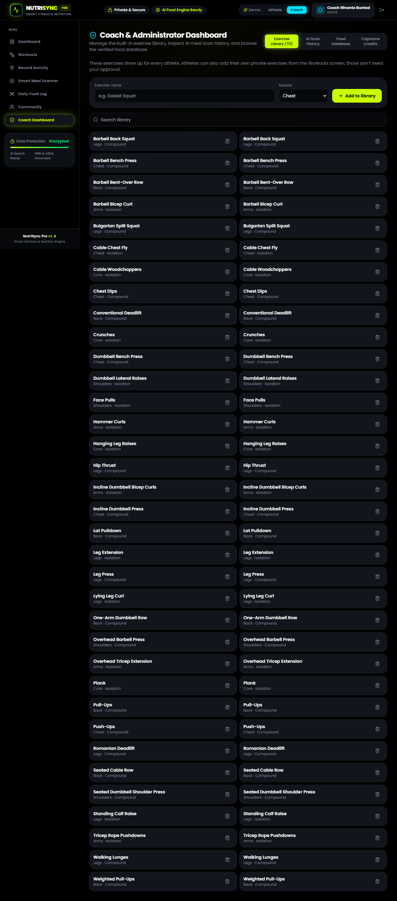

*Note:* verifying an athlete's personal record exists in the API (`PATCH /api/v1/workout-sets/{id}/verify`) but there is no screen for it yet.

## 5. Troubleshooting and FAQ

| Problem | What to do |
| :--- | :--- |
| "Too many login attempts" | Wait one minute and try again. |
| The site does not open | The host computer may be off. Try again later or contact support. |
| A food was not found by the scanner | Try a simpler name ("rice", "fried egg"), or add it by hand in the Daily Food Log. |
| The calories look wrong | Check the grams. The scanner assumes one serving when you give no amount. |
| Location does not work | Allow location for the site in the browser; GPS needs HTTPS. |
| I forgot my password | Password reset is not available yet. Ask the project team. |

## 6. Contact and support

**[PEOPLE]** Add the team's support email and the instructor's name here.
